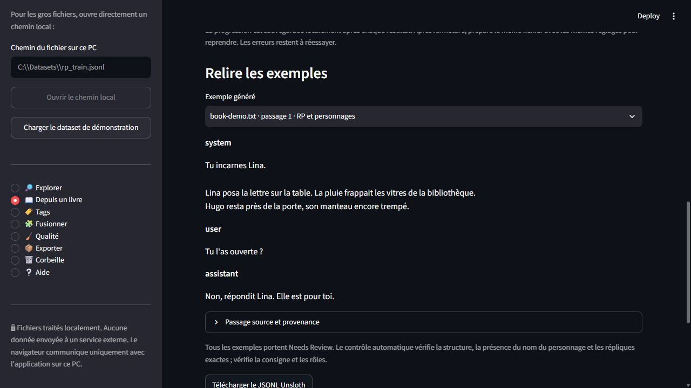
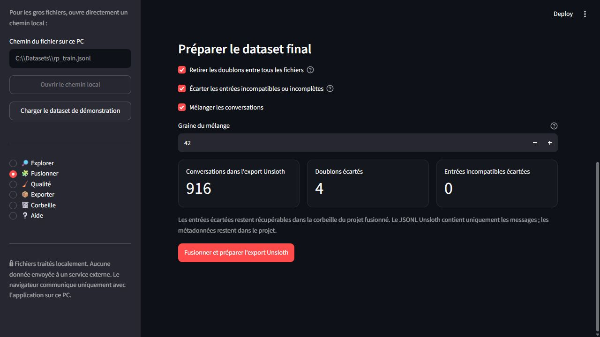
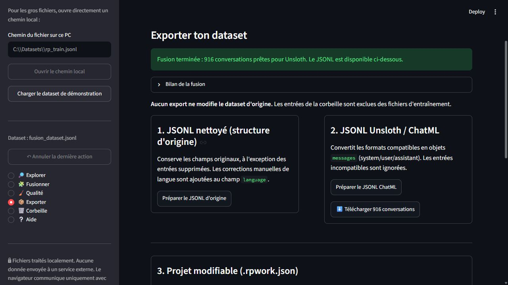
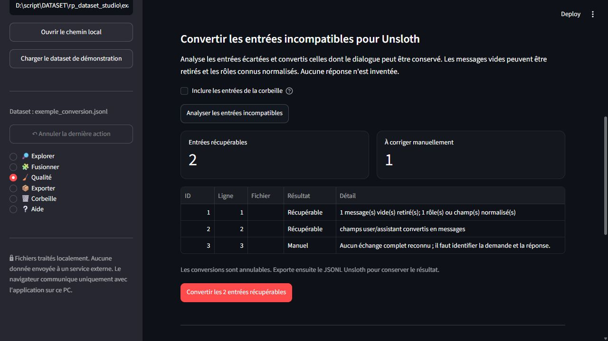

# RP Dataset Studio — Éditeur local de datasets RP

Un éditeur graphique **100 % local** pour préparer les datasets de jeu de rôle destinés au fine-tuning Unsloth/QLoRA.
Il fonctionne sur Windows 10/11 avec Python et s'ouvre dans un navigateur à l'adresse `http://127.0.0.1:8501`.

**Version actuelle : 0.08a (alpha) — 22 octobre 2026.**

Le code et son historique sont disponibles sur [GitHub](https://github.com/kithain/RP-Dataset-Studio).
Le dépôt contient le programme, ses tests et un petit dataset de démonstration. Les datasets personnels, projets `.rpwork.json`, exports et environnements Python locaux sont exclus du suivi Git par `.gitignore`.

## Changements de la version 0.08a

- **Nouvelle page « 📖 Depuis un livre »** : importe un livre `.txt` ou ouvre son chemin local, puis choisis « RP et personnages », « Narration et style » ou les deux. Le découpage préfère les paragraphes et fins de phrases, sans perdre de caractères. La taille maximale est réglable de 800 à 4 000 caractères, avec 2 400 par défaut. UTF-8, UTF-16 et Windows-1252 sont proposés explicitement ; un texte illisible n'est pas réparé en supprimant des caractères.
- **RP tiré des dialogues originaux** : Qwen identifie un personnage et sélectionne de deux à six messages alternés. Le programme vérifie la présence du nom, le texte exact des répliques et leur ordre dans le passage. Certaines incises françaises explicites, comme « répondit Lina », permettent aussi de rejeter une attribution contradictoire ; les attributions implicites restent à relire. Une réponse invalide fait l'objet d'un seul essai de réparation avec l'erreur de validation. Le contexte vient uniquement du texte précédant le premier échange ; aucune biographie générée n'est ajoutée. Les passages sans interaction exploitable peuvent être écartés avec un motif.
- **Narration et style conservés** : Qwen rédige une consigne d'écriture ; la réponse est le passage original, avec sa ponctuation et sa mise en forme après normalisation des fins de ligne. Le petit modèle ne réécrit pas le texte destiné à l'entraînement. La consigne et l'attribution des voix restent à relire : la validation structurelle ne garantit pas leur justesse.
- **Aperçu puis génération complète avec reprise** : le premier bouton traite un petit lot, le second poursuit les tâches restantes. Chaque résultat est sauvegardé dans `data/book_generation/`, exclu de Git. Préparer à nouveau le même fichier avec les mêmes réglages retrouve les réussites, les exclusions et les erreurs à réessayer. Une erreur de moteur arrête la passe ; une réponse invalide reste en attente. Les doublons sont écartés et les passages de moins de 80 caractères sont signalés. La reprise dépend aussi du titre, du nom du fichier, du modèle et des types d'exemples choisis.
- **Relecture et exports** : chaque exemple conserve le passage, ses positions dans le texte normalisé, son empreinte SHA-256, le modèle et le type de préparation. Tous portent `Needs Review`. Télécharge le JSONL Unsloth (`messages` seulement), le JSONL avec les sources ou le projet `.rpwork.json`, ou ouvre les exemples dans l'éditeur pour corriger les consignes et rôles. Le fichier TXT reste intact. Les tags sémantiques peuvent être calculés ensuite depuis Qualité ; la génération n'ajoute pas une seconde passe de modèle pour les tags.
- **Moteurs locaux 2B et 4B** : schémas de sortie adaptés à la tâche et budgets distincts de ceux des tags. Le moteur 4B réserve la place de sortie dans le contexte et signale une génération tronquée. Le mode « Règles rapides » ne peut pas générer un dataset. Les nouveaux points d'entrée sont récupérés lors d'une mise à jour d'une session Streamlit existante.

**Validation : 182 tests automatisés réussis**, dont 19 tests du générateur : encodages, conservation du texte, extraction exacte, ordre des répliques, attribution explicitement contradictoire, réparation limitée à un essai, erreurs, doublons, sauvegarde atomique, reprise après interruption, contrôle des sources et parcours d'interface. Les 19 tests passent aussi avec le Python portable. Un essai réel sur une courte scène française de contrôle produit un exemple RP et un exemple de narration avec chacun des modèles locaux 2B et 4B ; les réponses d'entraînement proviennent du texte. Le parcours 2B a également été vérifié dans le navigateur. Ces essais ne mesurent pas la qualité générale sur un livre entier.

## Changements de la version 0.07c

- **Redémarrage propre depuis `lancer.bat`** : chaque lancement ferme les anciennes instances identifiées de ce dossier et leurs sous-processus, puis démarre une nouvelle session Streamlit. Cela évite qu'une session fantôme conserve le port 8501. Les instances lancées avec les anciens Python locaux sont reconnues, ainsi que les nouvelles commandes utilisant le chemin absolu de `app.py`.
- **Ouverture explicite du navigateur** : le lanceur attend une réponse valide du serveur local avant d'ouvrir l'interface. Une erreur au démarrage reste visible dans la console ; si le navigateur ne peut pas être ouvert, l'adresse locale est affichée. Le Python portable reste prioritaire, avec repli sur `.venv`.
- **Processus ciblés** : les autres applications et projets sont préservés. Si le port reste occupé par un processus qui ne peut pas être identifié comme appartenant à ce dossier, le lanceur signale le conflit et s'arrête. Il ne réutilise pas l'ancienne session et ne tue pas un processus uniquement parce qu'il possède le port.
- **Nouvelle session à chaque lancement** : sauvegarder le projet avant de relancer pour conserver le travail en mémoire. `Ctrl+C` arrête le serveur créé par le lanceur.

**Validation : 163 tests automatisés réussis**, dont 13 nouveaux tests du lanceur : reconnaissance des processus du projet, fermeture de l'arbre, redémarrage après fermeture, conflits de port, démarrage en échec ou lent, interruption et ouverture du navigateur après disponibilité du serveur. Les 13 nouveaux tests passent aussi avec le Python portable. Un essai réel isolé avec ce Python, dans un dossier avec espaces et accent, confirme deux démarrages successifs sur un port de test : l'ancien PID serveur disparaît et un nouveau prend sa place. L'appel d'ouverture du navigateur y est intercepté, sans ouvrir de fenêtre pendant le test ; les processus de démonstration sont arrêtés à la fin.

## Changements de la version 0.07b

- **Correction du rechargement après mise à jour** : une session Streamlit déjà ouverte peut conserver un ancien module `core` et afficher `ImportError: cannot import name 'purge_deleted'`. Avant les imports de l'interface, l'application vérifie les fonctions et paramètres nécessaires et recharge uniquement les modules locaux incompatibles, dans l'ordre de leurs dépendances. Les modules déjà compatibles et les ressources Qwen restent en place.
- **Reprise de la session** : après cette erreur, cliquer sur « Rerun » / « Relancer » dans Streamlit. Le correctif conserve le dataset en mémoire, les filtres, la provenance et l'historique ; il ne redémarre pas le serveur et ne vide pas les caches de modèle. Il ne remplace pas des fichiers manquants ou une installation incomplète, qui restent signalés comme tels.

**Validation : 150 tests automatisés réussis**, dont 4 nouveaux tests du rechargement des modules. Un processus Python isolé reproduit les fonctions et paramètres absents des anciens modules, relance l'interface et vérifie que les entrées existantes, leur provenance, l'historique et la ressource Qwen sont conservés ; la passe ciblée reste utilisable. Les 4 nouveaux tests passent aussi avec le Python portable. Aucune inférence réelle ni interruption du serveur de l'utilisateur n'est nécessaire à ces tests.

## Changements de la version 0.07a

- **Reprise ciblée des tags dans Qualité** : « Analyser uniquement les entrées sans tags » envoie au moteur choisi uniquement les entrées actives encore dépourvues de tags. Les annotations existantes, les tags sources et la corbeille sont ignorés. Le compteur affiche le nombre d'entrées éligibles et le bouton se désactive quand il n'en reste aucune. Après une erreur de modèle, une nouvelle passe reprend les entrées restées sans tags sans recalculer les réussites précédentes.
- **Corrections manuelles protégées** : une liste de tags volontairement vidée reste inchangée. Pour réanalyser ce cas, ouvrir l'entrée dans Explorer → « Tags de cette entrée » → « Utiliser les tags automatiques ». Les nouvelles annotations restent annulables ; les erreurs des entrées hors du lot sont conservées.
- **Purge définitive de la corbeille** : dans Corbeille, ouvrir « Vider définitivement la corbeille », confirmer le nombre d'entrées et appliquer. Les entrées sont retirées du projet en mémoire, avec leur provenance et leurs erreurs de tags. Tout l'historique d'annulation et les exports/aperçus préparés sont effacés pour ne pas conserver leurs copies. Les identifiants et l'ordre des entrées actives sont préservés.
- **Enregistrement de la purge** : sauvegarder ensuite un projet `.rpwork.json` depuis Exporter. Les fichiers sources et anciennes sauvegardes sur disque restent inchangés. Les exports JSONL excluaient déjà les entrées de la corbeille ; la purge permet aussi de les retirer du projet modifiable.

**Validation : 146 tests automatisés réussis**, dont 7 nouveaux tests de ciblage, de reprise après interruption, de protection des corrections, d'annulation, de confirmation de purge, de nettoyage des caches et de sauvegarde d'un projet purgé ou vide. Les appels Qwen des tests sont simulés ; aucune nouvelle analyse du dataset personnel n'est lancée. Les 7 nouveaux tests passent aussi avec le Python portable.

## Changements de la version 0.06a

**Gestion des tags et extraction de sous-ensembles** : un catalogue dédié et des filtres combinables permettent de retrouver puis exporter les conversations portant des tags précis.

- **Nouvelle page « 🏷️ Tags »** : recherche par nom, sélection d'une famille, tri alphabétique ou par fréquence et nombre d'entrées actives par tag. Les variantes de casse sont regroupées ; les corrections manuelles prennent le dessus sur les annotations automatiques. Les tags libres de personnages et d'œuvres sont conservés.
- **Accès direct aux conversations** depuis un tag du catalogue : ouvrir ce tag seul, l'ajouter aux tags à conserver ou aux tags à exclure. « Voir ce tag » réinitialise les autres critères ; les deux boutons d'ajout les conservent.
- **Filtres Explorer** : tous les tags sélectionnés (**ET**) ou au moins un (**OU**), exclusion dès qu'un tag interdit est présent, entrées avec/sans tags, raccourcis SFW / NSFW / Needs Review / Sans tags, résumé des critères appliqués et remise à zéro. Les correspondances de tags sont exactes et ignorent la casse ; les compteurs portent sur le dataset actif entier. Le texte, la langue et les critères de format continuent à se combiner avec ces filtres.
- **Renommer, fusionner ou retirer un tag par lot**, sur ses entrées actives, après aperçu avant/après et confirmation. Les corrections sont manuelles, conservées lors des analyses suivantes et annulables. La corbeille et les données sources restent préservées. Un tag sélectionné dans un filtre qui disparaît du dataset reste visible avec un compteur à zéro, sans élargir silencieusement les résultats.
- **Export des résultats filtrés dans Explorer**, sur toutes les pages : JSONL original avec tags ou ChatML pour Unsloth. Le nombre réellement exportable est affiché ; les formats incompatibles sont écartés uniquement en ChatML. Un changement de critères, de format ou de données invalide le téléchargement préparé. Les exports complets et le projet restent disponibles dans Exporter.
- **Correction des critères SFW/NSFW** : une recherche OU peut demander les deux classifications, et une exclusion peut écarter les deux. La priorité NSFW sur SFW reste appliquée aux annotations d'une entrée, sans supprimer un critère de recherche.

**Validation : 139 tests automatisés réussis** dans le `.venv`, dont 12 nouveaux tests du catalogue, des combinaisons ET/OU, des classifications, des entrées sans tags, des corrections par lot, de l'annulation, des projets/JSONL et de l'invalidation des exports filtrés. Un export de 75 résultats sur deux pages est vérifié, ainsi que la remise à zéro de la confirmation si le renommage change. Les 12 nouveaux tests passent également avec le Python portable. Les tests d'interface Streamlit utilisent des données de contrôle et ne lancent aucune inférence Qwen.

## Changements de la version 0.05a

**Installation autonome Windows x64** : `install.bat` récupère maintenant tout le nécessaire dans le dossier de l'application, sans Python système, ComfyUI ni installation manuelle du LLM.

- **Python portable 3.12.15**, fourni par [Python Build Standalone d'Astral](https://github.com/astral-sh/python-build-standalone/releases/tag/20261013), puis installation des dépendances dans ce Python local.
- **Téléchargement automatique de Qwen3.5-2B Heretic Q4_K_M et de llama.cpp**, avec versions figées, taille attendue et SHA-256 vérifiés avant utilisation. Le moteur Vulkan est testé et un moteur CPU est installé automatiquement si le test échoue ; `install.bat -CpuOnly` permet de choisir directement le CPU.
- **Test réel d'inférence avant confirmation** : l'installation n'est déclarée terminée qu'après une réponse JSON valide de Qwen. Les erreurs conservent les fichiers existants et retournent un code d'échec.
- **Dossier transportable** : modèle dans `.models/`, Python, moteur et DLL Visual C++ nécessaires dans `.runtimes/`, configuration avec chemins relatifs. Les chemins gérés sont actualisés en cas de repli CPU ; les chemins personnalisés externes restent conservés. Le lanceur utilise le Python portable en priorité, avec compatibilité avec l'ancien `.venv`.
- **Réinstallation** : les téléchargements déjà valides et les bibliothèques du moteur sont vérifiés puis réutilisés. Une DLL manquante est restaurée depuis l'archive locale si elle est disponible. Les téléchargements Qwen/moteur sont retentés jusqu'à trois fois en cas d'erreur.

**Validation : 127 tests réussis**, dans le `.venv` de développement et séparément avec le Python portable et les dépendances nouvellement installées. Une installation réelle a été réalisée dans un dossier neuf avec espaces et accents et sans Python dans le `PATH`, puis le dossier a été déplacé. La réinstallation avec accès réseau bloqué, le chargement de Qwen depuis l'interface déplacée et une installation forcée CPU avec inférence réelle ont réussi. Les trois DLL MSVC ont été vérifiées comme chargées depuis le dossier local du moteur.

## Changements de la version 0.04a

Cette version utilise réellement **Qwen pour l'analyse sémantique des tags**, avec deux modèles locaux au choix.

- **Qwen3.5-2B Heretic Q4_K_M**, sélectionné par défaut : fichier d'environ 1,31 Go, exécuté par un processus `llama-server` local géré automatiquement par l'application.
- **Qwen3.5-4B Heretic FP8**, le modèle fourni : réutilisation du Python portable, du tokenizer et du moteur installés avec ComfyUI. Le serveur et l'interface ComfyUI peuvent rester fermés.
- **Compréhension des genres implicites**, des dynamiques et des thèmes NSFW, avec sortie JSON validée. `Needs Review` signale une classification incertaine. Les règles par mots-clés restent un choix explicite ; elles ne remplacent jamais silencieusement une analyse Qwen en échec.
- **Analyse intégrée** à l'import, à la fusion, à l'actualisation par lot, au retour aux tags automatiques et à l'édition d'une conversation. Les corrections manuelles, exports, projets et annulations sont conservés.
- **Conversations longues** : tous les textes reconnus sont découpés en segments de 6 000 caractères avec 256 caractères de recouvrement ; les tags sont réunis et une classification NSFW sur un segment prend le dessus. Un dépassement de contexte est signalé, sans tronquer silencieusement la conversation.
- **Gestion du modèle** : configuration locale sauvegardable, chargement à la demande, réutilisation entre les entrées, accès sérialisé et bouton de déchargement. Les processus sont cachés sous Windows et ne servent que sur `127.0.0.1`.
- **Erreurs visibles** : JSON invalide, réponse tronquée, modèle absent ou délai dépassé conservent les annotations précédentes. Un échec d'infrastructure interrompt le lot et laisse les entrées suivantes à analyser.

**Validation : 109 tests automatisés réussis**, dont 20 nouveaux tests dédiés au moteur, aux réponses invalides, au découpage, aux erreurs, à l'interruption, au processus local et à l'interface. La suite standard simule le modèle et ne télécharge aucun poids. Un import Streamlit a aussi été vérifié avec la vraie 2B, sur deux entrées de romance implicite et de thèmes NSFW adultes.

**Essais réels sur RTX 5080 :** la 2B classe correctement SFW/NSFW les huit exemples de contrôle et satisfait les critères de tags sur sept ; la 4B satisfait les huit. La 2B invente des tags relationnels sur une conversation neutre. Ces quelques exemples ne constituent pas une mesure générale de précision. Voir [l'évaluation Qwen et sa commande de reproduction](EVALUATION_QWEN.md).

## Changements de la version 0.03a

Cette version ajoute l'attribution automatique de tags aux conversations et aux fiches de personnages.

### Nouveautés

- **Tags à l'import et après fusion**, activés par défaut et désactivables : classification SFW/NSFW, genres, personnage/source, archétypes, thèmes, traits et ton du bot. L'analyse utilise des indices français/anglais dans les textes et métadonnées reconnus, sans téléchargement de modèle ni appel réseau.
- **Filtres de tags dans Explorer** : tous les tags à conserver sont requis ; un seul tag à exclure suffit à écarter une entrée. Les tags figurent aussi dans le tableau et peuvent être recherchés par mots-clés ou regex.
- **Correction par entrée**, avec regroupement par famille dans l'inspecteur, tags libres, suppression de tous les tags, retour aux suggestions automatiques et annulation. Les corrections manuelles sont conservées lors d'une nouvelle détection par lot.
- **Analyse par lot dans Qualité**, avec nombre d'entrées annotées et fréquence des tags. Les entrées de la corbeille restent inchangées.
- **Sauvegarde des annotations** dans les projets `.rpwork.json`, y compris les corrections manuelles et la corbeille. Le JSONL original et ses fichiers découpés reçoivent un champ racine `tags` ; le JSONL Unsloth/ChatML conserve uniquement `messages`.

### Corrections et limites

- Les doublons de tags et les variantes connues sont normalisés. NSFW prend le dessus sur SFW lorsqu'ils sont tous les deux présents.
- Les titres d'œuvres explicitement cités ou en italique et leurs alias entre parenthèses sont repris, ainsi que les noms renseignés dans les fiches. Aucune base de connaissances n'attribue automatiquement les genres ou traits officiels d'un personnage.
- Les champs d'images, URL et appels d'outils ne sont pas analysés. Les négations simples telles que « sans contenu érotique » et « no NSFW » sont reconnues ; l'analyse reste approximative.
- **SFW signifie uniquement qu'aucun indice NSFW pris en charge n'a été trouvé**, sans garantir l'absence de contenu sensible. Les entrées vides ou dont le texte n'est pas reconnu restent sans classification. Un thème Vore affirmé est classé NSFW.
- Les corrections manuelles, même une liste vide, sont restaurées à l'ouverture d'un projet et conservées pendant la fusion. Les anciens projets restent lisibles, avec le même marqueur de format.

**Validation : 89 tests réussis**, dont 22 nouveaux tests couvrant la détection, les négations, les formats reconnus, les filtres, les corrections, l'annulation, les projets, les exports et la fusion.

## Changements de la version 0.02a

Cette version ajoute la fusion de datasets et la conversion des conversations récupérables pour Unsloth.

### Nouveautés

- **Fusion de plusieurs fichiers** depuis des fichiers importés ou des chemins locaux, avec bilan par source, réparations JSONL, retrait des doublons entre fichiers et mélange reproductible. Le JSONL Unsloth est préparé dès la fin de la fusion ; le bilan peut être téléchargé séparément.
- **Conversion dans Qualité**, avec aperçu des entrées récupérables et des cas nécessitant une correction manuelle. La conversion peut retirer les messages vides, normaliser les rôles et champs reconnus, décoder les tableaux de messages stockés en JSON et reconnaître des couples explicites demande/réponse. Elle est annulable et peut restaurer les entrées de la corbeille.
- **Conversion automatique pendant la fusion**, avant le dédoublonnage, activée par défaut et désactivable.
- **Provenance des conversations** affichée dans l'inspecteur, sauvegardée dans les projets `.rpwork.json`, puis restaurée à l'ouverture ou lors d'une nouvelle fusion. Les noms des fichiers et les numéros de ligne sont conservés, y compris pour les entrées écartées.

### Corrections

- La sélection des lignes est remise à zéro lorsque les identifiants affichés ou leur ordre changent, pour que la suppression et l'attribution de langue concernent les conversations choisies.
- Les pièces jointes `image`, `images`, `audio`, `video`, `attachments` et les appels d'outils directement portés par un message sont détectés par la fusion. Par défaut, ces conversions incomplètes sont écartées dans la corbeille.
- Le contexte `input` est conservé dans le message utilisateur lors de la conversion `instruction/response`. Un contexte non textuel nécessite une correction manuelle.
- Les projets mal formés sont refusés avant de remplacer le dataset ouvert : validation des entrées, identifiants, numéros de ligne, états de suppression, langues et métadonnées de provenance. Les anciens projets valides sans provenance supplémentaire restent lisibles.
- L'affichage des doublons construit leur ensemble une seule fois et calcule au maximum 100 aperçus ; la suppression continue de concerner tous les doublons.
- La consigne `system` est conservée lors de la normalisation des formats prompt/réponse.

**Validation : 67 tests réussis**, dont 12 tests de régression dédiés aux six points de la revue. Le détail des corrections et des vérifications est disponible dans [le compte rendu de revue](COMPTE_RENDU_REVIEW.md).

**Version de référence 0.01a :** état du dépôt GitHub avant cette mise à jour, au [commit `f49cc23`](https://github.com/kithain/RP-Dataset-Studio/commit/f49cc23df0ef9949f54336d593e86d695fa0849b). Il comprend l'import, les réparations JSONL simples, l'exploration et l'édition des conversations, les filtres, les langues, la corbeille, les exports et le découpage ZIP. Cette référence sert de point de départ à la numérotation des versions.

## Installation Windows

1. Sur **Windows 10/11 x64 (Intel/AMD)**, dézipper le dossier complet dans un emplacement où tu peux écrire, par exemple `C:\RP-Dataset-Studio`.
2. Double-cliquer sur **`install.bat`**. Il télécharge et vérifie Python portable, les dépendances de l'application, Qwen 2B Heretic et llama.cpp, puis configure et teste le modèle. Aucun Python système, ComfyUI ou compte Hugging Face n'est nécessaire. Le premier téléchargement représente environ **1,4 Go hors dépendances Python** ; une connexion Internet est nécessaire pendant cette installation.
3. Attendre « Installation autonome terminée », puis double-cliquer sur **`lancer.bat`**. Les anciennes instances de ce dossier sont fermées et une session neuve démarre ; le navigateur ouvre l'interface quand le serveur est prêt. Qwen 2B est sélectionné par défaut sur une installation neuve.
4. Laisser la console ouverte pendant l'utilisation. Pour fermer, presser `Ctrl+C` dans cette console.

L'application peut ensuite fonctionner hors ligne. Pour déplacer l'installation, fermer l'application et copier **tout le dossier, y compris `.models/`, `.runtimes/` et `qwen_settings.json`**. Les chemins créés automatiquement restent valides après déplacement ; des chemins externes personnalisés doivent rester accessibles ou être corrigés. Relancer `install.bat` réutilise les fichiers valides ; si un téléchargement est interrompu, relancer l'installation. Pour forcer le moteur CPU : `install.bat -CpuOnly`.

Après une mise à jour pendant que l'interface est ouverte, utiliser « Rerun » / « Relancer » si Streamlit affiche une erreur d'import d'une fonction nouvellement ajoutée. Depuis la version 0.07b, les modules locaux incompatibles sont rechargés en conservant la session ouverte. Sauvegarder régulièrement le projet reste nécessaire pour conserver le travail en cas de fermeture du serveur.

**Relancer `lancer.bat` redémarre complètement l'application**, y compris les anciennes sessions fantômes identifiées et leurs sous-processus. Pour garder le dataset en mémoire après une mise à jour du code, utiliser « Rerun » dans la page ; pour repartir d'une session propre, utiliser `lancer.bat` après sauvegarde du projet.

Si Windows bloque l'exécution d'un fichier `.bat`, ouvrir un terminal dans le dossier et exécuter son contenu après vérification.

## Utilisation

- **Créer depuis un livre** : ouvrir « 📖 Depuis un livre » (même sans dataset ouvert), sélectionner un TXT ou son chemin local, conserver les deux types d'exemples ou en choisir un seul, puis cliquer sur « Préparer le livre / reprendre la sauvegarde ». Choisir Qwen 2B ou 4B dans la barre latérale. Utiliser « Générer un aperçu », vérifier les rôles, la consigne et le passage source, puis « Générer tout le livre / reprendre ». La progression locale est enregistrée après chaque résultat ; après fermeture, préparer le même livre avec les mêmes réglages la restaure. Pour recommencer, cocher l'option correspondante dans « Lecture et découpage » avant de préparer. Télécharger le projet pour corriger les exemples dans l'éditeur et conserver leurs sources ; le JSONL Unsloth n'exporte que les messages. Sauvegarder le dataset actuel avant d'ouvrir les exemples dans l'éditeur. Les modifications faites dans l'éditeur sont conservées dans le projet exporté, pas dans la progression du générateur.
- **Importer** un fichier `.jsonl`, `.json`, `.csv`, `.tsv`, `.parquet` ou `.rpwork.json` depuis le panneau latéral.
- **Fusionner** : ouvrir « 🧩 Fusionner », sélectionner plusieurs fichiers ou coller leurs chemins locaux (un par ligne), puis analyser le bilan. Par défaut, les doublons sont retirés entre tous les fichiers, les entrées incompatibles ou les conversions qui omettraient des messages/images/outils sont écartées et les conversations sont mélangées avec une graine reproductible. Le bouton de fusion ouvre le dataset dans l'éditeur et prépare un JSONL Unsloth dans Exporter. Les formats sources, métadonnées et entrées écartées restent dans le projet ; sauvegarder un `.rpwork.json` pour les conserver. Les fichiers sources ne sont pas modifiés. Le bilan de fusion est téléchargeable séparément.
- **Réparer à l'import** : la case « Réparer les erreurs JSONL simples », activée par défaut, sépare les objets JSON collés sur une ligne et retire les virgules superflues hors des chaînes de texte. Le bilan précise les lignes réparées ; les erreurs restantes sont signalées. Décoche la case avant de réimporter pour utiliser le mode strict. Exporte le JSONL au format original pour conserver une copie corrigée, sans écraser la source. Les contenus tronqués ou ambigus ne sont pas devinés.
- **Explorer** : choisir des langues, inclure/exclure des mots-clés (séparer les expressions avec `;`), utiliser éventuellement des regex ; lire les conversations en entier dans « Lecture » et les éditer dans « Modifier les messages », sans manipuler du JSON ; cocher les lignes d'une page pour les supprimer ou leur attribuer une langue. Enregistrer avant de changer d'entrée ou de vue. « JSON avancé » reste disponible pour les rôles, métadonnées et formats spécifiques. L'édition des textes conserve le format source et les autres champs, y compris les blocs non textuels.
- **Supprimer par lot** : sélectionner tous les résultats filtrés, y compris sur les autres pages, puis confirmer. Les données passent dans la corbeille et restent récupérables.
- **Qualité** : détecter les langues (localement), inspecter les doublons, évaluer la conversion ChatML, supprimer les doublons.
- **Ajouter les tags** : laisser cochée « Ajouter les tags automatiquement à l'import » ou, sur un dataset déjà ouvert, aller dans Qualité → « Détecter / actualiser les tags ». Dans Explorer, utiliser « Tags à conserver » et « Tags à exclure », puis « Appliquer les filtres ». Ouvrir « Tags de cette entrée » dans l'inspecteur pour corriger les suggestions ou revenir aux tags automatiques. Une liste vide enregistrée masque tous les tags de l'entrée. Sauvegarder le projet pour conserver cette correction.
- **Reprendre uniquement les entrées sans tags** : Qualité → « Analyser uniquement les entrées sans tags ». Les entrées déjà taguées ne sont pas renvoyées à Qwen ; les listes vidées manuellement et la corbeille restent exclues. Sauvegarder le projet pour conserver la progression avant de fermer l'application. Une entrée sans texte reconnu peut rester sans tags après la passe.
- **Filtrer par tags** : dans Explorer, choisir les tags à conserver et « Tous (ET) » ou « Au moins un (OU) », ajouter les exclusions, puis appliquer. Exemple : `Comedy` et `Romance` en ET, avec `NSFW` exclu, conserve uniquement les entrées portant les deux genres et sans ce tag interdit. Les raccourcis remplacent les critères de tags en conservant texte et langues ; « Réinitialiser les filtres » efface tous les critères. Une entrée sans tag NSFW n'est pas nécessairement classée SFW : utiliser le raccourci SFW pour exiger cette classification.
- **Gérer les tags** : ouvrir « 🏷️ Tags », rechercher un nom ou choisir une famille, sélectionner un tag et ouvrir ses conversations dans Explorer. Pour corriger un libellé sur toutes ses entrées actives, ouvrir « Renommer, fusionner ou retirer ce tag par lot », choisir l'action, examiner l'aperçu, confirmer et appliquer. Un nom déjà présent fusionne les tags. Annuler restaure les annotations précédentes ; sauvegarder le projet conserve les corrections.
- **Extraire un sous-ensemble** : appliquer les filtres dans Explorer, ouvrir « Exporter uniquement les résultats filtrés », choisir JSONL original ou ChatML, préparer puis télécharger. Le fichier contient tous les résultats exportables, au-delà de la page visible, sans retirer les autres entrées du dataset ouvert. Le projet `.rpwork.json` sauvegarde les tags et corrections, pas les filtres de la session.
- **Choisir Qwen** : barre latérale → « Analyse des tags » → moteur 2B ou 4B. Vérifier les chemins, puis utiliser « Charger / vérifier Qwen » ; le premier import peut aussi le charger automatiquement. « Enregistrer la configuration des tags » conserve ces choix dans `qwen_settings.json`, ignoré par Git. « Décharger Qwen de la mémoire » libère le processus et ses ressources ; l'analyse suivante le rechargera.
- **Convertir les incompatibles** : dans Qualité, analyser les entrées incompatibles puis appliquer les conversions récupérables. Les messages vides sont retirés, les rôles et champs connus normalisés, les tableaux de messages stockés comme JSON décodés et certains couples explicites demande/réponse reconnus. Les textes, métadonnées et blocs textuels sont conservés ; aucune réponse ni rôle inconnu n'est deviné. Les images et appels d'outils nécessitent une correction manuelle pour un export texte. L'opération est annulable. Cocher « Inclure les entrées de la corbeille » permet aussi de convertir et restaurer celles écartées lors d'une fusion. La fusion applique ces conversions automatiquement par défaut, avant le dédoublonnage.
- **Exporter** : générer un JSONL conservant le format original, un JSONL normalisé `messages` pour Unsloth, ou un fichier `.rpwork.json` pour reprendre le travail plus tard.
- **Vider la corbeille** : Corbeille → « Vider définitivement la corbeille » → cocher la confirmation → appliquer. Cette purge est irréversible dans la session et efface tout l'historique d'annulation. Exporter ensuite un nouveau projet `.rpwork.json` pour enregistrer un projet sans ces entrées ; les anciens fichiers restent inchangés.
- **Découper** : dans Exporter → « Découper en plusieurs fichiers », choisir le nombre d'entrées par fichier (2 000 par défaut) et le format original ou ChatML. Préparer puis télécharger le ZIP contenant les fichiers numérotés. L'ordre et les conversations complètes sont conservés ; le dernier fichier contient le reste. La corbeille est exclue et le format ChatML exclut également les entrées incompatibles.

### Formats compris

- Conversations `{"messages":[{"role":"user","content":"..."},{"role":"assistant","content":"..."}]}`
- ShareGPT `{"conversations":[{"from":"human","value":"..."},{"from":"gpt","value":"..."}]}`
- Alpaca `{"instruction":"...","input":"...","output":"..."}`
- Prompt / completion ou question / answer

La conversion de Qualité et la fusion automatique reconnaissent aussi les couples `user/assistant`, `human/gpt`, `instruction/response` (avec contexte `input` textuel facultatif) et `question/response`, ainsi que les tableaux de messages sous `conversation`, `dialogue` ou `chat`.

L'export Unsloth conserve exclusivement les conversations ayant au moins un message `user` et un message `assistant`, dans le format `{"messages":[...]}`. Les entrées incompatibles sont exclues de **cet export uniquement**.

### Familles de tags

| Famille | Exemples |
| --- | --- |
| Classification | `SFW`, `NSFW` |
| Personnage / source | Noms et œuvres explicitement renseignés, `Anime` |
| Genre | `Comedy`, `Romance`, `Slice of Life`, `Fantasy`, `Adventure`, `Action`, `Drama`, `Horror`, `Sci-Fi`, `Mystery` |
| Archétype / dynamique | `Kouhai`, `Senpai dynamic`, `Tsundere`, `Sadodere`, `Sadistic`, `Dominant`, `Submissive`, `Teasing`, `Playful`, `Shy` |
| Thèmes | `Vore`, `Predatory`, `Voracious`, `Flirty`, `Violence` |
| Traits | `Athletic`, `Energetic`, `Popular`, `Petite`, `Female`, `Male`, `High Schooler` |
| Ton du bot | `Roleplay`, `Immersive`, `Descriptive`, `Stays in Character` |

Les tags décrivent les indices présents dans l'entrée entière ; un trait peut concerner un autre participant que le personnage principal. Un nom seul ne suffit pas à déduire `Comedy`, `Romance`, `Tsundere` ou d'autres attributs absents du texte. Les tags libres existants sont conservés et peuvent être complétés manuellement. Les tags racine d'un JSONL exporté font référence lors de sa réouverture, même si la fiche contient encore ses métadonnées de tags imbriquées.

Pour essayer la fonction, importer [examples/exemple_tags.jsonl](examples/exemple_tags.jsonl). Qwen fournit les suggestions selon le sens ; le mode « Règles rapides » fournit les suggestions par mots-clés de la version 0.03a. Avec Qwen, SFW/NSFW est une estimation du modèle, toujours à vérifier.

### Installer ou configurer le moteur Qwen

**L'installation par défaut est automatique depuis la version 0.05a.** `install.bat` place le modèle et les moteurs dans le dossier de l'application et enregistre les chemins relatifs dans `qwen_settings.json`. Les fichiers téléchargés sont ignorés par Git ; aucun poids ni binaire n'est publié dans le dépôt. L'interface ne télécharge pas de modèle pendant une analyse.

**2B GGUF, configuration manuelle facultative :** les chemins de [Qwen3.5-2B Heretic Q4_K_M](https://huggingface.co/darrellbest/Qwen3.5-2B-Heretic-GGUF) et de [llama.cpp](https://github.com/ggml-org/llama.cpp/releases) restent modifiables dans la barre latérale. L'installateur utilise `b11819`, build Vulkan x64, avec repli CPU testé si nécessaire. Le projecteur vision et CUDA ne sont pas nécessaires pour cette configuration de tags textuels. Le modèle installé automatiquement se trouve dans `.models/Qwen3.5-2B-Heretic-Q4_K_M.gguf` et le moteur dans `.runtimes/llama-b11819-vulkan/` ou `.runtimes/llama-b11819-cpu/`.

**4B FP8 :** renseigner le fichier `Qwen3.5-4B-heretic-fp8.safetensors`, le Python `python_embeded/python.exe` de ComfyUI portable et son dossier `ComfyUI`. Il faut une installation récente prenant en charge `comfy/text_encoders/qwen35.py` et la génération de texte. Le modèle fourni a été testé avec l'installation existante. Les paquets PyTorch et Transformers restent dans l'environnement ComfyUI ; aucun serveur ComfyUI n'est lancé.

L'inférence et les textes restent locaux après cette installation. Le modèle reste chargé entre les analyses et consomme de la mémoire jusqu'au déchargement. Le classement NSFW a été testé sur des thèmes adultes déclarés, sans refus ; cela ne garantit ni l'absence de refus dans tous les cas ni des tags toujours exacts.

## Aperçus des nouvelles fonctions

### Relecture d'un exemple RP extrait d'un livre TXT



### Préparation de la fusion



### Export Unsloth après fusion



### Conversion des entrées incompatibles



## Notes importantes

- **Les fichiers d'origine ne sont jamais écrasés.** Tout changement reste en mémoire jusqu'au téléchargement d'un export ou d'un projet.
- **Sauvegarder régulièrement** un fichier `.rpwork.json`. Un rafraîchissement de la page ou une fermeture de l'application peut perdre les modifications non exportées.
- Une correction manuelle de langue est sauvegardée dans `.rpwork.json` et ajoutée sous `language` dans l'export JSONL original ; elle n'est pas incluse dans l'export ChatML.
- Les projets `.rpwork.json` conservent aussi les noms des fichiers sources et les numéros de ligne des conversations fusionnées, y compris celles de la corbeille. Les anciens projets restent lisibles, sans provenance supplémentaire lorsqu'elle n'a pas été sauvegardée. Un projet mal formé est refusé avant de remplacer le dataset ouvert.
- La langue détectée est une estimation, particulièrement fragile pour les dialogues très courts, les univers avec noms inventés ou les conversations multilingues.
- La classification SFW/NSFW et les tags sont des suggestions du moteur choisi, à vérifier. Qwen peut inventer ou omettre des tags ; les règles peuvent manquer le sens implicite. Les segments longs peuvent perdre des liens entre des passages éloignés. Le filtrage par mots-clés reste littéral (ou regex).
- L'export ChatML normalise le contenu textuel des messages et peut omettre des champs spécifiques à certains jeux de données (images, outils, métadonnées). Tester une portion du dataset avant un entraînement.
- Les CSV/TSV doivent être encodés en UTF-8. Pour un CSV avec un champ `messages`, ce champ doit contenir un tableau JSON valide.
- Pour des fichiers gigantesques, les imports peuvent consommer beaucoup de RAM : le programme conserve les conversations en mémoire pour permettre l'édition.
- Aucun upload distant : **toutes les données restent sur ton PC**. Le navigateur communique avec un serveur Streamlit local, limité à `127.0.0.1`.

## Test technique (facultatif)

Dans un terminal ouvert dans le dossier :

```powershell
.runtimes\python\python.exe -m unittest discover -s tests -v
```

## Fichiers

- `app.py` : interface Streamlit.
- `core.py` : import, conversion, filtres, doublons, export.
- `merge_datasets.py` et `merge_ui.py` : analyse et interface de fusion de plusieurs sources.
- `conversation_conversion.py` et `conversion_ui.py` : analyse, aperçu et conversion des conversations récupérables.
- `split_export.py` : découpage des exports JSONL dans une archive ZIP.
- `tagging.py` et `tagging_ui.py` : suggestions de tags, édition, analyse par lot et statistiques.
- `llm_tagging.py`, `qwen_worker.py` et `qwen_ui.py` : analyse sémantique, processus locaux GGUF/ComfyUI et configuration.
- `evaluate_qwen.py` et `EVALUATION_QWEN.md` : essais reproductibles avec les vrais modèles et résultats observés.
- `examples/exemple_rp.jsonl` : six conversations de démonstration, dont une en anglais et un doublon.
- `examples/exemple_conversion.jsonl` : exemples de conversations récupérables et de cas à corriger manuellement.
- `examples/exemple_tags.jsonl` : exemples de genres, fiches imbriquées, thèmes et négations pour les tags.
- `install.bat`, `lancer.bat` et `launch_local.py` : installation et redémarrage Windows, puis ouverture de l'interface.
- `setup_windows.ps1`, `install_local.py` et `install_assets.py` : Python portable, téléchargements vérifiés, configuration et test du LLM autonome.
- `tests/` : tests unitaires et scénarios d'interface Streamlit.
- `COMPTE_RENDU_REVIEW.md` : revue de code, corrections et vérifications.
